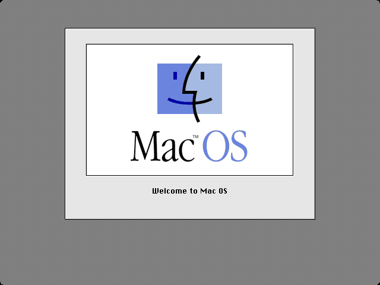
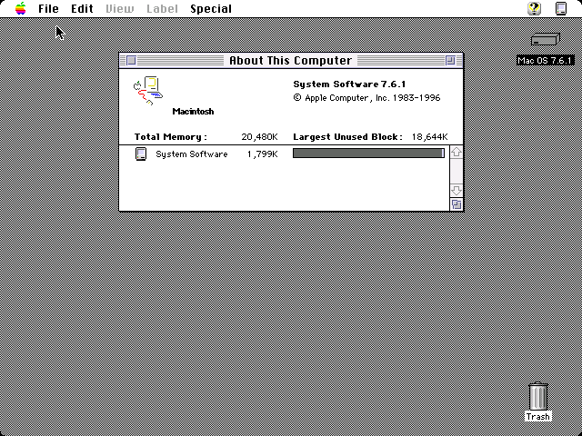
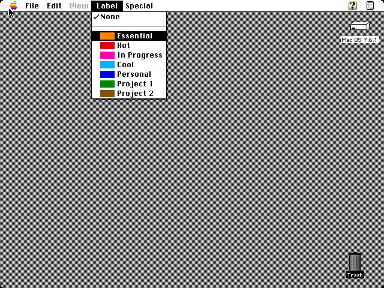
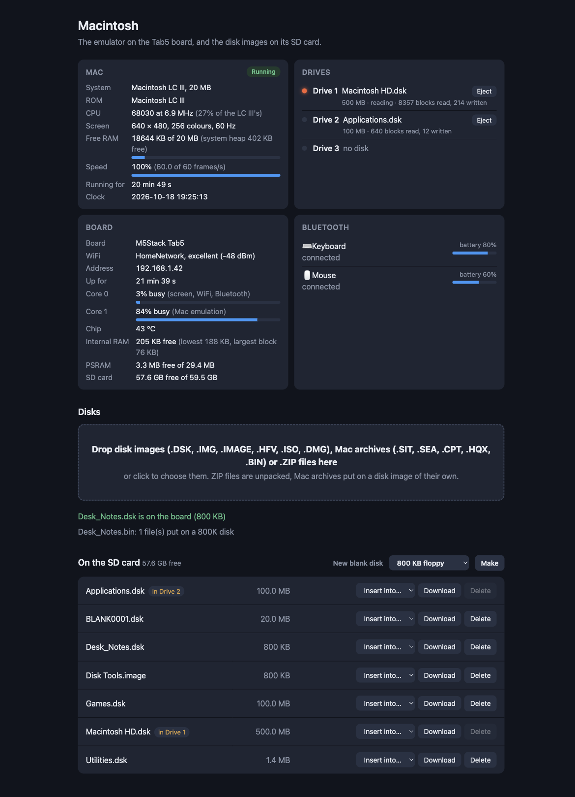
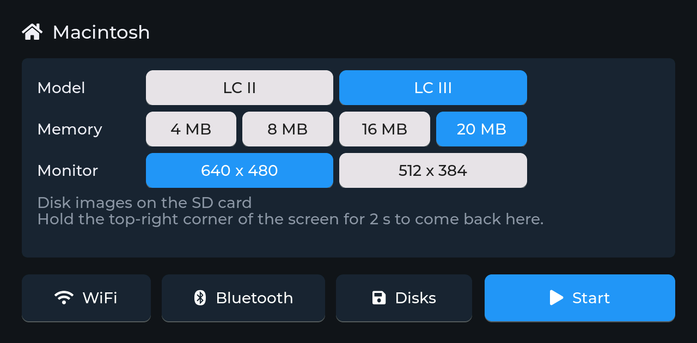
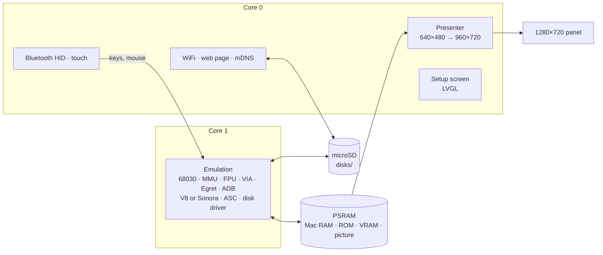

<h1 align="center">esp32mac3</h1>

<p align="center">
  <b>A Macintosh LC II or LC III on an M5Stack Tab5.</b><br>
  68030 with its MMU and FPU, 640×480 in 256 colours, up to 20 MB, Mac OS 7.6.1, disk images of any size in three drives, Bluetooth keyboard and mouse, the touch screen as the mouse.
</p>

<p align="center">
  
  
  
  
  
</p>

<p align="center">
  
  
  <br>
  
  
  <br>
  <sub>Mac OS 7.6.1 starting on the LC II, and its About This Computer with 10 MB; the LC III
  with 20 MB, and the Finder's Label menu. 640×480 in 256 colours, from the desktop build of
  the same emulator (<code>components/mac3/host</code>). Mac OS 7.6.1 calls all of these Macs
  just "Macintosh".</sub>
</p>

esp32mac3 turns an M5Stack Tab5 into a 68030 Mac, chosen on its setup
screen: the **Macintosh LC II** (a 68030 at 15.67 MHz on the V8 chip's 16-bit
bus, its built-in video, Egret, the Apple Sound Chip) or the **Macintosh
LC III** (a 68030 at 25 MHz on the Sonora chip: a 32-bit machine with 1 MB
of video RAM and stereo sound). Both show a 13-inch (640×480) or 12-inch
(512×384) monitor and run Mac OS 7.6.1. A Bluetooth keyboard and mouse (or
your finger on the screen) work the Mac, and disk images on the microSD
card go into three drives. A setup screen on the touch panel, and a web
page on your network, handle everything else.

It's the 68030 sibling of
[esp32mac2](https://github.com/rlucencic/esp32mac2) (Macintosh LC and II,
a 68020) and [esp32mac](https://github.com/rlucencic/esp32mac) (the compact
black-and-white Macs: Plus, SE and Classic), next to
[esp32ste](https://github.com/rlucencic/esp32ste) (Atari STE),
[esp32cpc](https://github.com/rlucencic/esp32cpc) (Amstrad CPC),
[esp32zx](https://github.com/rlucencic/esp32zx) (ZX Spectrum),
[esp32cbm](https://github.com/rlucencic/esp32cbm) (Commodore 64 and 128),
[esp32xl](https://github.com/rlucencic/esp32xl) (Atari 800XL and 130XE),
[esp32msx](https://github.com/rlucencic/esp32msx) (MSX1 and MSX2) and
[esp32gs](https://github.com/rlucencic/esp32gs) (Apple IIGS); all are built
on the shared runtime [esp32emu](https://github.com/rlucencic/esp32emu),
which also holds the 68030 core.

## Features

**The machines**
- **68030 with its paged MMU** ([Musashi](https://github.com/kstenerud/Musashi)
  core, its MMU rewritten for these ROMs): the ROMs build their own page
  tables and switch between 24-bit and 32-bit addressing as on the real
  thing; and a 68882 FPU, as if the optional chip were fitted
- **Macintosh LC II**: 4, 6, 8 or 10 MB (4 MB on the board and a SIMM pair);
  built-in video at 640×480 in black and white up to 256 colours, or
  512×384 up to thousands; Egret for the ADB keyboard and mouse, the clock
  and parameter RAM; the V8's Apple Sound Chip
- **Macintosh LC III**: 4, 8, 16 or 20 MB; Sonora's full 32-bit memory map
  and 1 MB of video RAM (up to thousands of colours at 640×480 too); Egret;
  Sonora's stereo sound
- A 13-inch (640×480) or 12-inch (512×384) monitor, chosen on the setup
  screen; 256 colours by default
- **Always in real time** (sound, clock, mouse): the 68030 runs as fast as
  the board keeps up, at most the model's own speed. On the Tab5 that's
  about 92% of an LC II, and 27% of an LC III (see Limitations); the web
  page shows the speed live
- The startup chime, system beeps and sound through the Apple Sound Chip,
  on the Tab5's speaker
- The clock is set from the internet; each model's parameter RAM (the
  control panels' settings) is kept across power-offs

**Disks**
- **Three drives** for disk images of any size, floppies and hard disks
  alike, through a fast replacement of the Mac's disk driver (from esp32mac)
- Mac OS 7.6.1 tested on both machines (at every memory size on the
  desktop build)
- Raw images (`.dsk`, `.img`, `.hfv`), Disk Copy 4.2 images (`.image`),
  partitioned hard disk images (`.hda`), CD images (`.iso`, `.toast`,
  locked as CDs are) and uncompressed `.dmg` images (read-only)
- **Mac archives straight from the old download sites**: StuffIt (`.sit`,
  `.sea`), Compact Pro (`.cpt`), BinHex (`.hqx`) and MacBinary (`.bin`)
  files dropped on the web page are unpacked in your browser and put on a
  disk image of their own, ready to insert
- **New blank disks** from the web page (800 KB and 1.4 MB floppies, 20,
  100 or 500 MB hard disks) or the setup screen (800 KB); the Mac offers to
  initialise them
- Disks inserted while the Mac runs appear on the desktop; ejecting one on
  the Mac frees the drive

**Around it**
- **Touch screen as mouse**: the pointer goes where you touch, and a touch
  clicks
- **Setup screen** before the Mac starts, and any time while it runs (hold the
  top-right corner for 2 seconds): WiFi, Bluetooth pairing, model, memory,
  monitor, disks, reset
- **Bluetooth keyboard and mouse** (BLE HID), with battery levels
- **Web page** at `http://macintosh3.local`: drop disk images, Mac archives or
  `.ZIP` files onto it (with a progress bar), put them into drives, eject,
  make blank disks, and watch the Mac (its CPU speed and free memory),
  drives, board and Bluetooth devices live
- **Sound** on the Tab5's speaker (on by default)

<p align="center">
  
  <br><sub>The web page, right after a MacBinary file was dropped on it and became a disk image (example data)</sub>
</p>

## Hardware

An [M5Stack Tab5](https://docs.m5stack.com/en/core/Tab5):

| | |
|---|---|
| Chip | ESP32-P4 (RISC-V, 360 MHz): 16 MB flash, 32 MB PSRAM; an ESP32-C6 for WiFi and Bluetooth |
| Screen | 5" 1280×720 MIPI-DSI, capacitive touch, held landscape |
| Storage | microSD card (FAT32 or exFAT) |
| Input | any BLE keyboard and mouse, the touch screen, or the Tab5 Keyboard |
| Sound | the built-in speaker (ES8388) |

The Mac's picture is shown at 4:3, 960×720 in the middle of the panel,
smoothly scaled. With 20 MB of Mac RAM, 3.3 MB of the PSRAM is left for the
rest of the board.

The Makerfabs MaTouch ESP32-S3 7", the other board of the sibling
projects, isn't supported: its ESP32-S3 is far too slow for a 68030.

## Getting started

### 1. What you need

- [ESP-IDF](https://github.com/espressif/esp-idf) v5.5 (developed with v5.5.4)
- [esp32emu](https://github.com/rlucencic/esp32emu), checked out next to this project (`../esp32emu`)
- Macintosh ROM images, which are copyrighted and **not included**: dumps of
  your own LC II ROM (512 KB) as `roms/lc2.rom` and LC III ROM (1 MB, also
  the LC III+'s) as `roms/lc3.rom`. They're recognised by their checksums
  (see [roms/README.md](roms/README.md)).
- A microSD card, FAT32 or exFAT, and a disk image with Mac OS 7.6.1 on it
  (the Mac OS 7.6.1 install CD's image starts these Macs as it is).
  Old Mac software is preserved on sites such as
  [Macintosh Garden](https://macintoshgarden.org) and the
  [Internet Archive](https://archive.org).

### 2. Build and flash

```sh
git clone https://github.com/rlucencic/esp32emu.git     # the shared runtime, next to it
git clone https://github.com/rlucencic/esp32mac3.git && cd esp32mac3
idf.py -B build-tab5 -DIDF_TARGET=esp32p4 -DSDKCONFIG=build-tab5/sdkconfig build
idf.py -B build-tab5 -DIDF_TARGET=esp32p4 -DSDKCONFIG=build-tab5/sdkconfig -p /dev/cu.usbmodem… flash   # app and the ROMs
```

Later updates only need `app-flash` instead of `flash`. Instead of flashing
the ROMs, you can also copy them into a `roms` folder on the SD card. The
Tab5 is the only target: a build for any other stops with a message.

### 3. First start

1. The board starts on the **setup screen**. Tap **WiFi** to join your
   network: the clock is set from the internet, and the web page becomes
   reachable.
2. Open `http://macintosh3.local` and drop a Mac OS 7.6.1 disk image onto
   the page, then choose **Insert into… → Drive 1**. (A 256 MB image takes
   about ten minutes to upload; you can also copy it into the `disks`
   folder of the SD card.)
3. Tap **Bluetooth** to pair a keyboard and mouse (optional: the touch
   screen is a mouse too).
4. Choose the **model**, **memory** and **monitor**, then tap **Start**. On
   its first start with a model's fresh parameter RAM, Mac OS 7.6.1 turns
   on 32-bit addressing and restarts once (a second startup chime is
   normal); then comes its desktop in 256 colours.

<p align="center">
  
  <br><sub>The setup screen on the Tab5, with the LC III and 20 MB chosen (its status lines left out)</sub>
</p>

## Using it

| To | Do |
|---|---|
| Get back to the setup screen | Hold the top-right corner of the screen for 2 s |
| Change the model, memory or monitor | On the setup screen; **Restart** applies it |
| Click | Tap the screen, or use the Bluetooth mouse (any button) |
| Insert a disk | Web page: **Insert into…**, or setup screen → **Disks** |
| Eject a disk | Drag it to the Trash on the Mac (frees the drive), or **Eject** on the web page |
| Make a blank disk | Web page: **New blank disk** (choose the size), or setup screen → **Disks** → **New** (800 KB) |
| Copy disk images from a computer | Drop them onto the web page (ZIP files are unpacked) |
| Use a program downloaded as `.sit`, `.cpt`, `.hqx` or `.bin` | Drop the file onto the web page: it becomes a disk image named after it |
| …or from the command line | `curl -T MacOS.dsk http://macintosh3.local/disks/` |

Disk images live in the `disks` folder on the SD card. The inserted disks
are remembered across restarts, and so is each model's parameter RAM.

**Keyboard**: by position, as on Apple's Extended Keyboard (US). Command is
the Windows/⌘ key, Option is Alt, Control is Ctrl; Backspace is Delete,
Delete is the forward delete, Insert is Help, Num Lock is Clear; F1-F15,
Home, End, Page Up and Page Down and the keypad as themselves.

## Configuration

`idf.py menuconfig` → **Emulator board**:

| Option | Default | |
|---|---|---|
| WiFi, setup screen | on | Time zone for the clock (POSIX TZ) |
| Start by itself | off | Countdown on the setup screen |
| Web page, network name | on, `macintosh3` | `http://<name>.local` |
| BLE keyboard and mouse | on | Mouse speed divider |
| Sound on the speaker | on | Volume |

## How it works



- **`components/mac3`**: the LC II and LC III, platform independent (one
  file for each machine's memory map, the chips shared). It also builds on
  a desktop (`components/mac3/host`) for testing with scripted keyboard and
  mouse, screenshots, sound recording, CPU, MMU and I/O traces.
- **`main`**: the Mac on the board: memory, ROMs, settings, the CPU speed,
  keyboard map, touch, drives and status.
- **[esp32emu](https://github.com/rlucencic/esp32emu)**: the board runtime and
  the CPU core, built as a 68030 here (`CONFIG_M68K_68030`).

The Mac's time is counted in machine cycles at 15.6672 MHz: a "line" of 704
cycles is one sound sample (22.255 kHz), 370 lines a frame (60.15 Hz). The
68030's cycles are scaled to each model's own pace (the LC II's 16-bit bus,
the LC III's 25 MHz on 32 bits), and before each frame a controller sets how
fast the CPU runs: as fast as the frame still fits in 85% of its time,
slowing down quickly and speeding up slowly, never past the model's speed.
So the clock, the sound and the mouse stay real while the CPU gives what the
board has.

The MMU translates every access, instruction fetches included; a small cache
of recently used pages keeps that to about 2% of the emulation's time. The
ROMs are patched in memory, every patch checked against the expected bytes:
no ROM checksum test, and the `.Sony` floppy driver replaced by esp32mac's
small paravirtual one, which reads and writes disk images block by block:
that's why any image size works, without emulating the floppy controller or
SCSI. Egret is emulated at the level of its packets, with the handshake the
ROMs themselves use.

## Development

```sh
make -C components/mac3/host                                       # desktop build of the Macs
MAC_DISK1=MacOS.dsk components/mac3/host/build/mac_host roms/lc2.rom 3600 lc2.ppm 10
MAC_DISK1=MacOS.dsk components/mac3/host/build/mac_host roms/lc3.rom 3600 lc3.ppm 20

python ../esp32emu/tools/emu_console.py /dev/cu.usbmodem… screenshot screen.png   # the Mac's screen
python ../esp32emu/tools/emu_console.py /dev/cu.usbmodem… send "R 1 20"           # restart as the LC III with 20 MB
curl http://macintosh3.local/api/status                                          # live status as JSON
```

The host build runs at each model's own speed (no controller), and takes a
script of timed keys, mouse moves and screenshots (`MAC_SCRIPT`), a
parameter RAM file (`MAC_PRAM`) and trace options. `CLAUDE.md` has the
details: the machines' maps and chips, the MMU, the ROM patches, debugging
options and the lessons learned along the way.

## Limitations

- **Speed**: the Tab5 emulates about an LC II's worth of 68030. At the idle
  Finder the LC II runs at ~92% of its real speed (14.5 MHz), the LC III at
  ~27% of its own (6.9 MHz: about as fast as the LC II, not faster), both
  with core 1 about 85% busy. The LC III's bigger memory and video are
  there all the same.
- New. On the Tab5, both machines start Mac OS 7.6.1 and run it in real
  time in 256 colours at 640×480; the setup screen and the pointer work
  (LC II with 8 MB, LC III with 8 and 20 MB). Not tried by
  hand yet: sound on the speaker, a Bluetooth keyboard and mouse, the Tab5
  Keyboard; not tried yet: the 12-inch monitor, other colour depths
  (thousands on the LC III).
- RAM sizes: the LC III takes 4, 8, 16 or 20 MB, the sizes its ROM finds
  with the RAM in one piece (12 MB isn't one of them).
- The CPU's pace for each model is an estimate, not yet calibrated against
  a real LC II or LC III.
- MMU faults don't raise exceptions, so no virtual memory.
- No SCSI devices, serial ports, AppleTalk, printer or PDS cards. The Mac's
  volume setting is ignored.
- Disk images are presented through the floppy driver: copy-protected
  originals that talk to the floppy hardware directly don't work.

## Credits

- [Musashi](https://github.com/kstenerud/Musashi) by Karl Stenerud (MIT
  licence), via Matt Evans' [fork](https://github.com/evansm7/Musashi) for
  embedded use
- [MAME](https://www.mamedev.org)'s Mac LC II and LC III drivers by R.
  Belmont (V8, Sonora, pseudo-VIA, ASC; hardware tests by Doug Brown), its
  Sonora video by O. Galibert, and its 68030 MMU, the reference for how
  these machines' chips behave
- Linux's `via-cuda.c` and QEMU's Cuda, for the Egret packets
- [Mini vMac](https://www.gryphel.com/c/minivmac/) and Matt Evans'
  [umac](https://github.com/evansm7/umac), via esp32mac
- [The Unarchiver](https://theunarchiver.com)'s XADMaster by Dag Ågren (LGPL),
  the reference for the StuffIt and Compact Pro formats (via esp32mac)
- [LVGL](https://lvgl.io) for the setup screen
- [ESP-IDF](https://github.com/espressif/esp-idf) and NimBLE

## Licence

[MIT](LICENSE). The Musashi core in esp32emu is MIT licensed too. LVGL (MIT)
and ESP-IDF (Apache 2.0) are fetched at build time and keep their own
licences.

The one exception is `main/web/macfiles.js`, the archive converter for the
web page (from esp32mac): it follows XADMaster closely, so it is under the
[GNU LGPL 2.1](https://www.gnu.org/licenses/old-licenses/lgpl-2.1.html) or
later.

Apple, Macintosh and Mac are trademarks of Apple Inc. This project contains
no Apple code; you need your own ROM images and system software.
